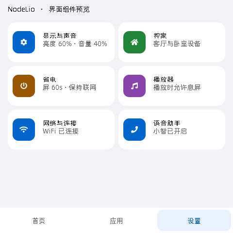
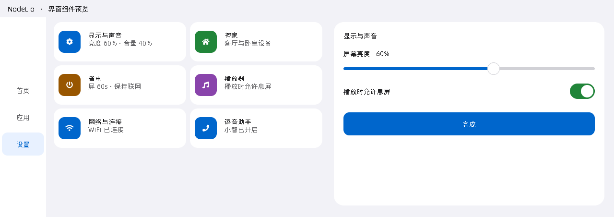

# NodeLio 面板交互重构

适用：`sila_86`（480×480）与 `sila_p4c5_62`（1280×452）。
几何仍由 `display_profile` 决定，业务协议、板型身份和语音服务不变。

## 页面与状态更新

共用 UI 代码已落实：

- 首页保留当前页和最多一个备用页。回到备用页时复用控件树，重新应用设备状态和技能摘要。
  只有不含相册、内容控件不超过 32 个的页面可作为备用页；相册页离开后不保留解码图片。
  第三页访问会淘汰原备用页；分配新页面失败时回退到当前容器重建。
- 布局、字体、控家设置、钉选或工作区尺寸改变时，清除备用页并标记当前页需要重建。
  隐藏页延后到显示时重建，但导航页数、页面 ID 立即同步，避免云端删页后仍沿用旧导航。
- 技能摘要只重建对应卡片的内容，不删除卡片本身、其他控件或相册。
  隐藏期间合并摘要更新；再次进入缓存页仍检查已有技能缓存的有效期，没有新增定时拉取。
- 应用列表最多复用 `APP_MAX` 个卡片槽。选中只改样式；列表内容改变时更新文字与可点击状态；
  分栏和字体变化只改几何及字体。列表缩短时释放多余卡片，条目重排后点击使用当前槽位数据。
  隐藏应用页停止分栏动画，返回时应用最终布局。
- 页面重建不再清除控制命令的等待/回滚状态。HTTP 结果和超时仍按原控制路径处理。
- 倒计时数据在翻页或隐藏期间继续递减，但隐藏或等待重建的控件树不执行角标更新。
- 单颗开关创建日志降为 debug，避免常规切页逐颗输出 info 日志。

- 网络状态突发更新只安排一个下一轮 LVGL 回调；触摸产生的乐观状态仍立即显示。
  每个控件保存在线、开关、PWM、倒计时与字体的显示快照，值未变时跳过样式重写。
  快照最多 64 份，随控件删除失效；超出容量仍正常绘制。
- 控制回执携带本地序号，旧命令的成功/失败不能清除或回滚同一控件的新请求。

## 独立面板壳

`panel_shell.*` 负责屏幕底色和复用通知。`NODELIO_NATIVE_SHELL` 默认开启：
`LcdDisplay::SetupUI()` 不再创建小智聊天、状态栏和低电弹窗控件树。
显示适配器把状态送到 AI 抽屉，字幕沿用面板聊天接口，通知使用独立 top 层提示。
主题/字号切换不再访问旧页面的空指针。时钟、网络和电池沿用面板已有状态采样，
低电提示复用该采样，不添加第二个轮询。

导航、技能、播放器和 AI 抽屉沿用现有显示层级；保留 `goto_page home` 不关闭技能浮层，
截图仍覆盖 `lv_layer_top()`。可关闭 `NODELIO_NATIVE_SHELL` 构建旧壳作对照。
这项开关只改变壳，页面缓存和作业队列仍启用；完整改造前后对照应使用旧版本固件。

## 后台作业与请求生命周期

`panel_jobs.*` 将首页控家、应用打开/清单、技能摘要/钉选、相册、截图上传、DSH 详情/操作、
曲库换批接入三个队列：Control、Interactive、Background。每个队列最多 8 个等待任务、
一个执行任务。控家与后台摘要分别排队，用户打开应用不必等待整个后台下载队列。
原有常驻控家、换批任务取消；新 worker 按需创建，队列空后退出，无轮询任务。

worker 栈固定为 **16384 字节 PSRAM**。ESP-IDF 的创建接口使用字节数，已移除这些路径里
原先 `/ sizeof(StackType_t)` 的换算。仅队列持锁期间入队/取出，HTTP 不持队列锁、显示锁。
队列满或 worker 创建失败立即拒绝新提交，由调用点回滚/提示；不静默淘汰已接受的控制命令。
相册同控件的等待项、曲库换批等待项可替换，旧参数由 discard 回收。

打开新应用/详情或真正关闭技能会更新展示版本；旧只读等待项可丢弃，已经运行的 HTTP
在返回后校验版本。旧结果不会重新弹出旧卡片。技能结果进入应用调度后，在显示锁内再次
检查版本再接管数据。已接受的任务派发、审批等操作仍执行，展示失效不撤销业务命令。
最小化和普通主标签切换不撤销播放。相册仍有独立页面版本，过期等待项在解码前丢弃。

原 HTTP 超时、错误提示、DSH 禁自动重试、音频退让策略继续生效。队列中的控制请求仍受
既有 pending 超时策略约束；网络长时间无响应时应检查回滚与最终设备状态。流式播放、
语音、网络驱动和 OTA 保留各自专用任务，不与页面下载混用。

资源约束同步到同级 NodeLio 项目的 `ESP32-IDF/docs/hw-constraints.md`。
最大三个活动 worker 的栈合计 48KiB PSRAM，另计 TCB、队列、请求参数、响应/解码缓冲；
任务退出后的堆回收依赖 FreeRTOS idle。P4 必须验收 DSI + Hosted + 音频并发。

## 两块板的刷新策略

- S3：`NODELIO_S3_LVGL_TICK_MS` 默认 5ms，替换 RGB port 原先的 50ms 时钟粒度；
  可设回 50 做单变量对照。该参数不强制绘制，普通息屏仍停止 LVGL port；播放时只关背光、
  降刷新并保留触摸读取。
- 共用：`NODELIO_UI_ACTIVE_REFRESH_MS` 默认 30ms，范围 16–50ms，只影响脏区刷新周期。
- 共用息屏：`NODELIO_UI_IDLE_REFRESH_MS` 默认 200ms，适用于 P4 和 S3 播放息屏，
  唤醒恢复共用活动周期。P4 保留现有 RGB888、
  分块双缓冲与 PPA 输出旋转。PPA 填充/全屏缓冲沿用已有实验开关与板级变体，未强行开启。
- 未改 LCD 时序、引脚、板型身份、AES 策略、ES8389、DMA 归属或语音服务。

以上是代码默认值与可对照配置，尚无两块板的帧时、端到端延迟或电流测量，不能推断实际收益。

## 观测与验收

`nl_ui_perf` 在导航、首页构建/切换、技能更新和应用更新操作结束时记录 `mutation_us`。
超过 20ms 使用 warning，其余为 debug。没有轮询、额外刷新或日志定时器。
这些值只代表当前函数修改 UI 的墙钟耗时，不包含进入函数前的等待，也不等于显示帧率或
触摸到屏幕反馈的完整延迟。

P4 可结合现有板级 `NODELIO_P4_RENDER_STATS` 刷新统计使用，实验变体与容量限制见
[板级说明](../main/boards/sila/sila-p4c5-62/README.md)。不能把无绘制时段换算成低帧率。

两块板分别使用同一组操作，与修改前固件比较：

1. 首页至少三页，连续往返翻页 200 次，观察缓存命中与第三页淘汰。
2. 有天气/新闻组件时等待摘要返回，同时操作相邻开关；确认不闪整页、不重载相册。
3. 点击开关后立即切页，模拟失败/超时，再返回检查状态是否回滚。
4. 应用连续切换、展开/收起、动画中切主标签；确认无错位、失效点击或滚动位置异常。
5. 首页隐藏时下发布局，包含删页和重新排序；再通过触摸、语音返回首页及翻页。
6. 更改字号、开关控家、打开/关闭技能卡与底部播放器，检查缓存正确失效和布局尺寸。
7. 单张/多张相册翻页，检查迟到图片不落到新页、解码资源释放及再次进入后正常加载。
8. 重复播放/语音并发、断网、息屏和唤醒；记录内部堆、DMA 最大块、PSRAM 最低余量及音频欠载。

待实机验证目标：触摸可见反馈 P95 ≤80ms，已缓存页可操作时间 P95 ≤150ms；
有动画的场景先追求稳定 30fps，而非提高空闲刷新率。触摸端到端延迟需要输入时间戳配合
显示完成事件或高速摄影测量，不能从 `mutation_us` 单独推算。

## 主机验证

`scripts/tests/test_panel_ui_lifecycle.py` 从生产源码提取页面切换、失效处理、应用更新与
技能内容渲染函数，运行在真实 LVGL 对象上。整个首页构建器及网络业务用测试替身隔离；
因此测试覆盖对象复用、淘汰、几何更新与内容路由，不替代固件链接或硬件验证。

设置 `LVGL_SOURCE` 指向 LVGL 9 源码，`CXX` 指向主机编译器后运行：

```sh
python -m unittest discover -s scripts/tests -p test_panel_ui_lifecycle.py -v
python -m unittest discover -s scripts/tests -p test_panel_jobs.py -v
python -m unittest discover -s scripts/tests -v
```

本次使用 LVGL 9.5.0 与主机 C++ 编译器，覆盖连续 200 次缓存往返/应用分栏切换、隐藏期间
删页、摘要局部更新、倒计时、通知复用/到期、状态突发合并和控件地址复用。
`scripts/tests/test_panel_jobs.py` 编译实际调度器，用确定性 FreeRTOS 适配器验证容量/FIFO、
替换释放、任务创建失败、过期结果与不可取消操作、200 轮队列回绕、worker 退出；并提取实际
控家回执代码验证旧回执不影响新请求。该适配器不模拟 FreeRTOS 多核调度或真实 HTTP。

2026-11-01：界面生命周期/触摸/对比度 10 项、省电策略 1 项、作业队列 1 项通过。
完整套件运行 124 项，
报告 13 个 error（含子用例）、1 项跳过，仍有本改动之外的 Windows 临时目录清理、Bash 缺失、
通知流测试签名和 Ogg 日志桩问题。按项目交付规则，由用户使用 ESP-IDF 6.1 逐板编译/烧录；
本次未执行目标构建、分区体积检查、烧录或实机流畅度验收。

## 省电策略修正（2026-11-01）

- S3 息屏计时不再受旧 `wifi/sleep_mode` 键覆盖；其他板使用 `PowerSaveTimer` 的默认行为不变。
- S3 播放息屏同步 `screen_on=false`，刷新降至空闲周期，暂停状态/活动 UI 轮询。独立输入事件
  调度用户活动，保留媒体、网络和 LVGL 触摸读取；第一下只唤醒。普通息屏恢复 LVGL 前也等待
  触摸释放，避免睡眠触摸轮询采到的那一下穿透至首页控件。
- 照片轮播在息屏或首页隐藏时不再推进、提交新下载。已经在途的一次加载允许完成，避免丢弃
  单张相册的初始结果后永久停在加载占位。亮屏后下一次计时恢复轮播，不补发睡眠期间的帧。
- 设备信息页按有效断网能力显示状态，P4 保持 Hosted 联网；设备信息实时计数息屏暂停更新。
- 小智关闭时，音频服务通过应用提供的策略拒绝启动 WakeNet；迟到唤醒事件在进入 connecting、
  编码或打断播放前退出。媒体不再重试开启唤醒。保留用户关闭小智的设置，重新开启仍走现有
  保存并重启流程；音频自检、播放等独立能力不受此开关限制。
- 心跳静态任务按 ESP-IDF 的字节单位传递 10240 字节 PSRAM 栈，修正错误的 `/ sizeof(StackType_t)`。

`test_panel_power_policy.py` 编译实际照片计时、息屏开关、音频唤醒开关与应用唤醒函数，外部效果
用计数器隔离。覆盖关闭小智不编码、不建链、不暂停播放，重开恢复，以及非面板默认策略。
触摸测试使用真实 LVGL 输入设备和 S3 的实际输入回调。仍需实机确认 S3 触摸/I2C、P4 Hosted、
播放中息屏/唤醒、语音重开、离线控制与亮屏/息屏电流；没有开启未经验证的 DFS 或 light sleep。

## 浅色 Apple 风格

用户选择浅色 iOS Settings/Home 方向。设计依据是 Apple HIG 的
[颜色](https://developer.apple.com/design/human-interface-guidelines/color)、
[按钮](https://developer.apple.com/design/human-interface-guidelines/buttons)、
[材质](https://developer.apple.com/design/human-interface-guidelines/materials)与
[可访问性](https://developer.apple.com/design/human-interface-guidelines/accessibility)。
固件采用浅灰画布、白色分组卡片、蓝色操作重点、绿色开关和深色文字；使用现有字库与图标，
不引入 Apple 字体资产、实时模糊或玻璃合成。颜色/圆角在 `ui_theme.h`，共用按钮/滑块/开关/
导航在 `ui_widgets.*`；原有两种 `display_profile` 与网格坐标保持兼容。

首页自定义颜色转为浅底，彩色图标与状态徽标按背景选择黑/白前景；应用与设置入口统一圆角卡片；
连接页、技能操作、新闻朗读及小智浮层同步浅色主题。对话浮层不透明，浮动控件去除光晕阴影。
规则已写入 `.agents/skills/lvgl-smart-panel-design/SKILL.md`，技能格式校验通过。

以下是生产共用控件在真实 LVGL 中的演示数据样张，使用内置 14px 中文字库；不是整机截图，
也不代表云布局中每一种首页卡片。目标设备仍需检查三档字号、弹窗、键盘、长标题、离线/未知态。





可选地设置 `PANEL_UI_PREVIEW_DIR` 为已经存在的目录，再运行界面生命周期测试，即可输出两个
RGB PPM 样张。测试覆盖常用文字色、主按钮按下态以及 216 种自定义背景的前景对比度；预览
不开启环境变量时不会写入文件，也不需要 Python 图像依赖。
